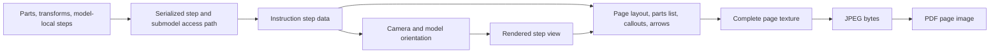

# BrickLink Studio Instruction Builder: PDF/image reconstruction investigation

Investigated 2026-11-14. Input scope confirmed by the user: **Studio-generated PDF or page images only**.

## Result

The installed Instruction Builder is reverse-engineerable managed CIL. Its PDF exporter renders each complete page to pixels, JPEG-encodes those pixels, and inserts the resulting image into a PDF. The examined exporter does not write the model's part transforms into the PDF.

Consequently, there is no demonstrated lossless PDF-to-model decoding path. Recovering the same assembly from these inputs requires **inverse rendering and assembly inference**. The reverse-engineered forward path gives us better camera priors, layout rules, highlight handling, and a way to design controlled examples. It does not recover invisible geometry from pixels.

This investigation produced static bytecode evidence and a reconstruction specification. It did not implement or validate a complete image-to-model solver. No actual Studio-generated user booklet was supplied or identified for an end-to-end reconstruction trial.

## Target and evidence

Installed application: `/Applications/Studio 2.0/Studio.app`, version `2.26.10_1` from its Info.plist.

| Artifact | SHA-256 | Module MVID |
| --- | --- | --- |
| `Studio.dll` | `e0b6e9fd3da3f6e99a50d6fe7dd9c90d00199bb6da88e4f57804ae3e4a16295d` | `4af622d8-89d6-4c8f-8d5e-71517246479c` |
| `Studio.Presentation.dll` | `d79bcf31eac45a3fca6c0738d500b85824b20fa178602b8906e804b67443e524` | `2d485232-9e62-4341-8be3-3b7b390dcb3c` |

Assemblies are under `Contents/Resources/Data/Managed/`. REA identifies Studio.dll as Unity Mono, CIL, AnyCPU. Its PE x86 header is not proof that the application is x86-only.

Full retained evidence: `../../output/rea-studio-instructions-2026-11-14/evidence.json`.
Readable selected bytecode: `../../output/rea-studio-instructions-2026-11-14/il/manifest.json` and the adjacent `.il.txt` files.

The generated IL is decoded bytecode with resolved token comments, **not recovered original C# source**. Every method file includes its binary digest, MVID, method token, body digest, and REA evidence ID. Tokens in this report apply only to the binary identity above.

| ID | REA evidence | Scope |
| --- | --- | --- |
| E1 | `ev_21b2e398817be49594bee18c7a9fd9b10696231c95ed637991f8e535f81d6d35` | Studio.dll classification and identity |
| E2 | `ev_274c0a0f3c378d6c4d256272a20a0e0588c0ee0f92616d11c0d753aa55031922` | Complete admitted inventory of 2,560 types; member decoding capacity-limited |
| E3 | `ev_3daa741cf6e3526686a88a9050d7493b8cfa6ae46cca648f4b4337d5db846e6d` | Six selected types: LDraw steps/writers, step references, preview world, V2 converter |
| E4 | `ev_bbc30907abb9cd8b34be33ca9c18ffc3200e52ac0ec2ee4322240fe2047e98ed` | Instruction data, step data, rendering extension, export dialog |
| E5 | `ev_6706f584a1b3a894034f4b25ff1eb0890bcb3f1e3ecab540d3d580706aac2b49` | PDF/PNG async state machines and LDraw readers |
| E6 | `ev_27aeff0ba094fe054a3de4392db3512e6b20186de0cf33595e931b3275742507` | CameraInfoUtility in Studio.Presentation.dll |

E3–E6 report complete coverage **within their selected types**. They are not whole-application call graphs. E2's empty member collections must not be interpreted as absence; focused selections resolved that capacity issue.

## Recovered forward path



This is a static relationship reconstruction from E3–E6, not an observed runtime trace.

### PDF is a rendered page

The relevant implementation is the compiler-generated async state machine:

`<RenderInsPagesAsPdfAsync>d__64.MoveNext`, token `0x06004d27`, E5.

| IL byte offset | Operation |
| --- | --- |
| `0x039a` (922) | Construct `sharpPDF.pdfDocument` |
| 1110–1121 | Assign page item metadata and `ForceToDraw` |
| 1568 | `UnityEngine.Camera.Render` |
| 1658 | `Texture2D.ReadPixels` |
| `0x06e1` (1761) | `ImageConversion.EncodeToJPG` |
| `0x070e` (1806) | `pdfDocument.addPage` |
| `0x0745` (1861) | `pdfPage.addImage` |
| `0x07b9` (1977) | `pdfDocument.createPDF` |

The image is inserted at `(0, 0)` using page dimensions. Export includes a density/tile rendering loop before encoding. Text labels, parts thumbnails, and model images are composited before the JPEG call.

**Implication:** For this exporter, use the PDF's original embedded page image when available. Do not depend on live PDF text spans or one embedded image per part. A screenshot also needs page rectification/cropping before analysis. OCR is necessary for rasterized step numbers and quantity labels.

Coverage limit: the third-party SharpPDF implementation was not inspected, and no generated PDF was inspected. The observed call site supplies a page JPEG; no geometry serialization is present in this selected method. Arbitrary PDFs might contain other content or attachments and should still be inventoried when supplied.

### Camera and framing

`Ins_RenderTextureWorldExtension.GenerateCameraControlInfoForStep`, token `0x06001555`, E4:

- With no incoming camera info, sets `Fai = -0.52359879` and `Theta = 0.78539819` (radians: approximately -30° and 45°).
- Sets `ZoomDistance = max(100, length(parentModel.bounds.size) * 4.2)`.
- Selects the target from the parent model center or the current step's part bounds, depending on a flag.
- These are initialization rules, not a guarantee that every exported view uses these values.

`GetCameraControlInfo`, token `0x06001547`, E4, reads step data through `IStepItemDataService`, uses the step's selected/default camera if available, and otherwise calls the generation/new/adjusted-camera helpers. It can consult the previous serialized step. A fixed camera for an entire booklet is therefore an unsafe assumption.

`SetCameraForStep`, token `0x0600154f`, E4:

1. Reset the preview world's position and rotation.
2. Call `CameraInfoUtility.UpdateCameraTransform(info, cameraTransform, 10000)`.
3. Set `camera.orthographicSize = max(1, info.OrthographicScale / argument2)` for ordinary finite values.
4. Apply target translation, model orientation and camera-space rotations to the preview world, then normalize the camera transform for rendering.

`CameraInfoUtility.UpdateCameraTransform`, token `0x06000051` in Studio.Presentation.dll, E6, includes angle wrapping, orbit rotations, pole handling, `LookAt`, and roll. The complete decoded method is retained. A direct Three.js yaw/pitch substitution has not been verified against these conventions.

**Implication:** Separate assembly transforms from display transforms. Fit camera scale, translation, view orientation, and model orientation per step, with a continuity prior. Start search near the observed default angles but allow custom views, flips, and roll. Orthographic scale is actively configured in the inspected path; the render camera resource's projection flag was not independently inspected.

### Highlighting, new parts, and submodels

`RenderGameWorldToRenderTextureWithHighlightBricks`, token `0x06001553`, E4:

- Reads `IsHighlightNewPart`, `HighlightNewPartColor`, and `HighlightNewPartThickness` from the instruction style.
- Multiplies thickness by a rendering argument.
- Checks a part's `ParentStep` against the rendered step before enabling its highlight.
- Skips hidden parts.

`GetScreenRectForNewPartsInStep`, token `0x0600154a`, E4, walks current-step parts, obtains their bounds vertices, projects them through the camera, and encapsulates their screen coordinates. This is a projected bounding-box operation, not proof of pixel visibility.

`Ins_SerializedLDrawStep`, E3, carries `AccessPath`, `LDrawStep`, `Index`, `IsForSubModelPreview`, and `SubModelPreviewMultiplier`. `AccessPath` is a list of part instances, so a global printed step number alone cannot identify a repeated submodel instance.

**Implication:** Preserve current-step identity, parent assembly, callout scope, and repeated-instance multiplicity. A colored contour can be a highlight instead of a brick color. Exploded or floating parts and arrows must be represented as presentation evidence; their drawn positions must not automatically become final assembly coordinates. Buffer-exchange collections are observed in instruction data, but their full displacement semantics were not traced in this pass.

### Instruction XML is upstream of the PDF

`Ins_InsData.InitWithByteArray`, token `0x06000da9`, E4, loads XML, performs V2 conversion, and initializes instruction collections. `writeToXMLDocument` / `write` serialize the instruction data.

Observed nodes include `Instruction`, `GlobalSetting`, `PageSetup`, `GlobalStyle`, `Pages`, `ContentItems`, `BufferExchangeCollectionData`, and `CallOutCollectionData`.

`Ins_StepItemData.InitWithXml` / `WriteToXml`, tokens `0x06000ecf` / `0x06000ed0`, E4, use keys including `SerializedIndex`, `StepPreview`, `cameraScale`, `TargetPos`, `cameraAngle`, `modelAngle`, and default-camera variants.

These values explain the page generation process. **Their presence inside the exported PDF has not been established.** PDF-only reconstruction cannot assume access to this XML.

### Optional per-step inventory export

`Ins_ExportDialog.DoExportBOM`, token `0x060015c6`, E4, writes:

```csv
PageNum, StepNum, BLItemID, BLColorID, Qty
```

It enumerates page/slot step metadata, reads the part list, obtains BrickLink item/color IDs, and calls `GetPartCount`. This is useful optional side information if available in a future dataset. The requested PDF/image-only workflow must work without it. BrickLink colors and LDraw color codes require an explicit mapping.

### Ground-truth geometry writer

`Services.LDraw.Writer.LDrawPartWriter.Write`, token `0x06003b21`, E3, emits standard type-1 lines and a separate extended type-11 branch when `IncludeStudioPartData` is enabled.

The type-1 transform conversion from Unity matrix `U` is:

```text
x y z = U.m03, U.m13, -U.m23
a b c = U.m00, U.m01, -U.m02
d e f = U.m10, U.m11, -U.m12
g h i = -U.m20, -U.m21, U.m22
```

Equivalently, `R_ldraw = S R_unity S` and `t_ldraw = S t_unity`, with `S = diag(1,1,-1)`. Translation passes through `RoundFloat(value, 1e-5)` before six-decimal formatting. Preserve this conversion when creating labelled examples; do not reflect an already-LDraw transform a second time.

`LDrawStepWriter.Write`, token `0x06003b28`, E3, writes primitives followed by step metadata, supporting `STEP`, `ROTSTEP REL/ABS/ADD/END`, and `STUDIOSTEPDESC`. `LDrawPartReader` and `LDrawStepReader`, E5, provide matching parse paths for extended records and rotation/step markers.

This is a way to obtain ground truth when generating controlled training or evaluation examples. It is not an inference that a PDF contains these records.

## Reconstruction design for PDF/pages only

The following is an implementation proposal informed by the static findings above, not recovered Studio inverse code.

1. **Normalize input.** Extract full-resolution embedded page rasters where possible; accept ordered PNG/JPEG inputs. Retain original page dimensions, image bytes and content hashes. Detect skew, crop, and incomplete screenshots.
2. **Recover page structure.** OCR step numbers, quantities, multipliers, and labels. Detect model views, parts lists, arrows, callout boxes and assembly previews as separate regions. Permit multiple steps on a page and multiple views for one assembly.
3. **Identify parts.** Match each parts-list thumbnail against locally rendered Studio/LDraw part candidates across view, color and outline variation. Retain top candidates and quantity confidence. Resolve printed/decorated parts separately. If no parts list is shown, broaden candidates and flag the loss of evidence.
4. **Recover the build graph.** Represent each main assembly, callout and repeated subassembly separately. Track local step IDs, ordered additions and multiplicity. Printed step numbers are labels, not unique database keys.
5. **Solve geometry sequentially.** Maintain a beam of candidate partial assemblies. Generate new placements from compatible connectors and collision checks, allowing off-grid/hinged poses when the part supports them. Jointly fit camera/framing and compare rendered assembly candidates to the view. Use stable previously placed geometry as registration evidence; raw pixel subtraction across unmatched cameras is unreliable.
6. **Use all visible evidence.** Score silhouette, internal edges, studs, color regions, part-thumbnail identity, quantity agreement, occlusion and connection validity. Treat highlight outlines and presentation arrows separately. Re-score candidates against subsequent views, where previously hidden pieces may become visible.
7. **Retain uncertainty.** Keep multiple candidates when evidence ties. Flag unresolved part identity, depth, hinge angle, submodel reuse and symmetry. Enforce quantity conservation. Do not call an assembly exact because its last silhouette matches.
8. **Emit and verify.** Write MPD with explicit assembly steps and submodels. Render every reconstructed step at the fitted view and produce comparison crops plus a review report. Save both display-camera estimates and model-space transforms so image fitting never silently changes the assembly.

Suggested objective (weights require empirical calibration):

```text
loss = silhouette + internal_edges + color_regions + thumbnail_identity
     + count_mismatch + collision_penalty + invalid_connection_penalty
     + camera_discontinuity + unexplained_visible_pixels
```

A fully occluded part, two visually identical parts, or a depth translation under a single orthographic view can remain unresolved. Connections, later views, or manual input can resolve some ambiguities; code inspection cannot guarantee a unique solution for every booklet.

## Existing BrickMotion integration points

These are repository observations, separate from shipped-app evidence:

| Local code | Observed behavior | Consequence |
| --- | --- | --- |
| `src/io/studioIo.ts` | Extracts `model.ldr` from `.io` | Existing exact-model route; outside the selected PDF/image input scope |
| `src/ldraw/parse.ts` | Recognizes `0 STEP`, but has no `ROTSTEP` branch and only parses type-1 references | Training/validation imports can lose rotated-step boundaries or extended part records; handle before using Studio files as answer keys |
| `src/io/ldrawImport.ts` | Converts parsed references and step separators to plans | Cannot restore separators or references already discarded by the parser |
| `python/booklet_mpd/rawimages.py` | Uses PDF image info and text spans | Needs a whole-page raster/OCR route for this Studio exporter |
| `python/booklet_mpd/camera_fit.py` | Fits camera from supplied known model parts; calls itself teacher-forced | Useful scoring infrastructure; its fit alone is not evidence of geometry recovered from an unknown image |
| `python/booklet_mpd/stepimage.py` | Removes thin red arrows and uses color/background heuristics | Review against Studio's configurable colored highlights and arbitrary page styles |
| `scripts/instructions-to-mpd.ts` | Existing booklet-to-plan entry point | Candidate integration point after Studio-specific extraction produces a compatible, audited step manifest |

No application behavior was changed during this research. The parser gaps above are observed limitations; they have not been fixed in this pass.

## Validation needed before claiming reconstruction works

Start with one actual Studio-generated PDF or ordered page-image set. The user's selected workflow needs no `.io` at inference time. For evaluation, independently retained source models are useful as hidden answer keys.

Use small controlled examples covering one brick per step, multiple same-color additions, repeated submodels/callouts, camera changes, highlights, hidden pieces, and exploded presentation. Include full-page JPEG PDF exports and page screenshots, with held-out assemblies separated from training examples.

Measure exact part/color/count accuracy, model-space pose error modulo valid symmetries, local build-step accuracy, assembly reuse, connection/collision validity, and per-step image residual. Fix the global coordinate frame before comparing poses. Evaluate both correctly reconstructed and ambiguous cases; report review coverage.

Unknowns remaining: real-export image structure corroboration; render camera resource projection flag; exact screen/page unit conversion; full buffer-exchange displacement handling; callout repetition serialization details; renderer material/edge matching; part identity accuracy on real screenshots; end-to-end reconstruction accuracy and runtime.

## Reproduce the evidence extraction

From the project root:

```sh
python3 scripts/extract-studio-rea-evidence.py \
  output/rea-studio-instructions-2026-11-14/evidence.json \
  output/rea-studio-instructions-2026-11-14/il
```

This command only reads retained evidence and writes annotated IL and a method manifest. It does not launch Studio or load its assemblies. Static inspection used no web sources, runtime injection, binary patches, or application configuration changes.
